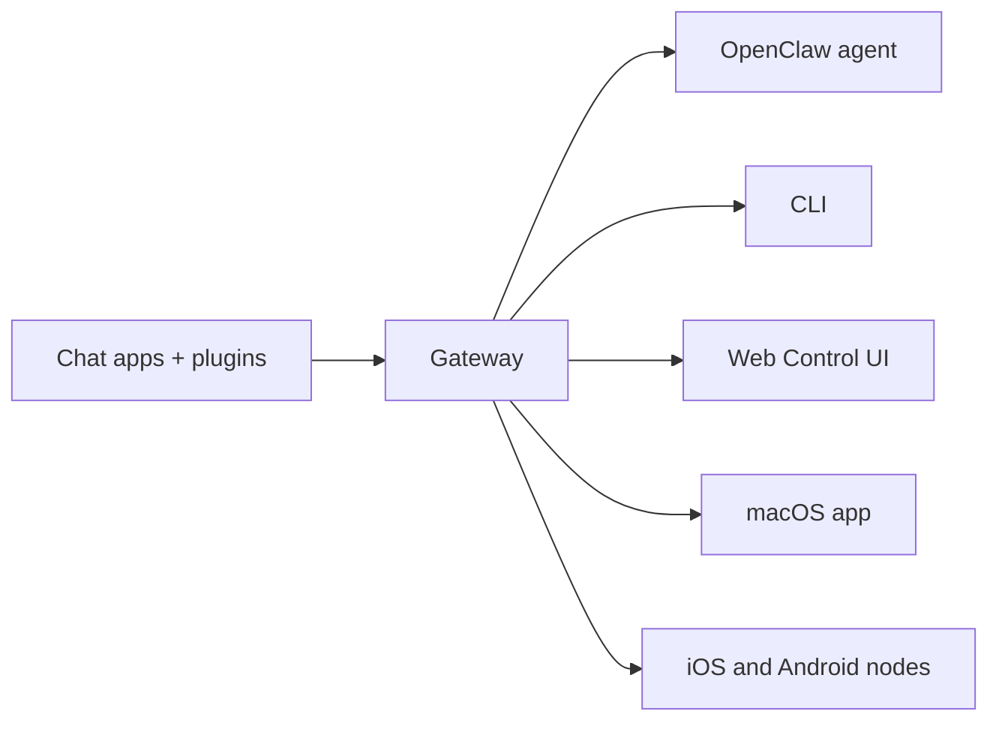

---
read_when:
    - Introduktion till OpenClaw för nybörjare
summary: OpenClaw är en AI-assistent med öppen källkod som körs på din egen hårdvara och möter dig i alla chattappar du redan använder.
title: OpenClaw
x-i18n:
    generated_at: "2026-10-15T00:25:42Z"
    postprocess_version: locale-links-v1
    prompt_version: 32
    source_hash: 469edde080c6c37e742cc8491273729c3c8ed94bcf240d11238744fa992914ae
    source_path: index.md
    workflow: 17
---

# OpenClaw 🦞

<p align="center">
    
    
</p>

> _"EXFOLIERA! EXFOLIERA!"_ — En rymdhummer, förmodligen

<p align="center">
  <strong>Din AI-assistent, på din egen hårdvara, i varje chattapp du redan använder.</strong><br />
  En Gateway. Valfri modell. Valfri enhet. Ingen värdbaserad tjänst som mellanhand.<br />
  Utvecklas öppet av <a href="https://openclaw.org">OpenClaw Foundation</a>, en oberoende 501(c)(3)-organisation. Ingen betalnivå, ingen telemetri som standard utöver en <a href="/gateway/telemetry">versionskontroll</a> som du kan stänga av, inget labb äger det.
</p>

<Columns>
  <Card title="Kom igång" href="/sv/start/getting-started" icon="rocket">
    Installera OpenClaw och starta Gateway på några minuter.
  </Card>
  <Card title="Kör första konfigurationen" href="/start/wizard" icon="list-checks">
    Guidad konfiguration med `openclaw onboard` och parkopplingsflöden.
  </Card>
  <Card title="Anslut en kanal" href="/channels" icon="message-circle">
    Anslut Discord, Signal, Telegram, WhatsApp och fler för att chatta var du än är.
  </Card>
  <Card title="Öppna kontrollgränssnittet" href="/web/control-ui" icon="layout-dashboard">
    Öppna webbläsarens kontrollpanel för chatt, konfiguration och sessioner.
  </Card>
</Columns>

## Bläddra i dokumentationen

Mobilwebbläsare kan visa avsnittsmenyn utan hela flikraden som finns på datorer. Använd
dessa översiktslänkar för att nå samma huvudområden i dokumentationen från sidans innehåll.

<Columns>
  <Card title="Kom igång" href="/sv/start/getting-started" icon="rocket">
    Översikt, första stegen och konfigurationsguider.
  </Card>
  <Card title="Installation" href="/install" icon="download">
    Installationsmetoder, uppdateringar, containrar, drift och avancerad konfiguration.
  </Card>
  <Card title="Kanaler" href="/channels" icon="messages-square">
    Meddelandekanaler, parkoppling, routning, åtkomstgrupper och kvalitetssäkring av kanaler.
  </Card>
  <Card title="Agenter" href="/concepts/architecture" icon="bot">
    Arkitektur, sessioner, kontext, minne och routning för flera agenter.
  </Card>
  <Card title="Funktioner" href="/tools" icon="wand-sparkles">
    Verktyg, Skills, Cron, webhooks och automatiseringsfunktioner.
  </Card>
  <Card title="ClawHub" href="/clawhub" icon="store">
    Marknadsplats för pluginer, publicering, urval och vägledning om tillit.
  </Card>
  <Card title="Modeller" href="/providers" icon="brain">
    Leverantörer, modellkonfiguration, redundansväxling och lokala modelltjänster.
  </Card>
  <Card title="Plattformar" href="/platforms" icon="monitor-smartphone">
    macOS, Windows, iOS, Android, noder och webbgränssnitt.
  </Card>
  <Card title="Gateway och drift" href="/gateway" icon="server">
    Konfiguration av Gateway, säkerhet, diagnostik och drift.
  </Card>
  <Card title="Referens" href="/cli" icon="terminal">
    CLI-referens, scheman, RPC och mallar.
  </Card>
  <Card title="Utgåvor" href="/releases" icon="tag">
    Versionsinformation för varje version, med höjdpunkter och källänkar.
  </Card>
  <Card title="Hjälp" href="/help" icon="life-buoy">
    Felsökning, vanliga frågor, testning, diagnostik och miljökontroller.
  </Card>
</Columns>

## Vad är OpenClaw?

OpenClaw är en **Gateway med egen drift** som ansluter dina favoritchattappar — Discord, Google Chat, iMessage, Matrix, Microsoft Teams, Signal, Slack, Telegram, WhatsApp, Zalo och fler via kanalpluginer — till AI-kodningsagenter. Du kör en enda Gateway-process på din egen dator (eller en server), och den blir länken mellan dina meddelandeappar och en AI-assistent som alltid är tillgänglig.

**Vem är det till för?** Utvecklare, avancerade användare och team som vill ha en AI-assistent de kan skicka meddelanden till var de än är — utan att ge upp kontrollen över sina data eller vara beroende av en värdbaserad tjänst. Samma Gateway körs som personlig assistent på en bärbar dator eller som en delad [teaminstallation](/start/teams); konfigurationen är den enda skillnaden.

**Vad gör det annorlunda?**

- **Egen drift**: körs på din hårdvara, enligt dina regler
- **Flera kanaler**: en Gateway betjänar alla konfigurerade kanalpluginer samtidigt
- **Byggt för agenter**: utformat för kodningsagenter med verktygsanvändning, sessioner, minne och routning för flera agenter
- **Öppen källkod**: MIT-licensierat, gemenskapsdrivet

Det fullständiga resonemanget bakom arkitekturen — en betrodd Gateway, obetrodd körning, policy som upprätthålls av kod och hur en produkt täcker både personlig användning och teamanvändning — finns i [Varför OpenClaw](/start/why-openclaw).

**Vad behöver du?** Node 26 (rekommenderas), eller en annan version som stöds: Node 24.16+ eller Node 26.1+. Du behöver också en API-nyckel från din valda leverantör och 5 minuter. För bästa kvalitet och säkerhet, använd den starkaste tillgängliga modellen av den senaste generationen.

## Så fungerar det



Gateway är den enda auktoritativa källan för sessioner, routning och kanalanslutningar.

## Viktiga funktioner

<Columns>
  <Card title="Gateway för flera kanaler" icon="network" href="/channels">
    Discord, iMessage, Signal, Slack, Telegram, WhatsApp, WebChat och fler med en enda Gateway-process.
  </Card>
  <Card title="Pluginkanaler" icon="plug" href="/tools/plugin">
    Kanalpluginer lägger till Matrix, Nostr, Twitch, Zalo och fler; officiella pluginer installeras vid behov.
  </Card>
  <Card title="Routning för flera agenter" icon="route" href="/concepts/multi-agent">
    Isolerade sessioner per agent, arbetsyta eller avsändare.
  </Card>
  <Card title="Mediestöd" icon="image" href="/nodes/images">
    Skicka och ta emot bilder, ljud och dokument.
  </Card>
  <Card title="Kontrollgränssnitt på webben" icon="monitor" href="/web/control-ui">
    Kontrollpanel i webbläsaren för chatt, konfiguration, sessioner och noder.
  </Card>
  <Card title="Mobila noder" icon="smartphone" href="/nodes">
    Parkoppla iOS- och Android-noder för arbetsflöden med kamera, skärm och röst.
  </Card>
  <Card title="Skills" icon="graduation-cap" href="/tools/skills">
    Lär agenten upprepningsbara procedurer som den läser in vid behov.
  </Card>
  <Card title="Automatisering" icon="clock" href="/automation">
    Kör arbete enligt ett schema med Cron-jobb, händelsekrokar och webhooks.
  </Card>
  <Card title="Bygg pluginer" icon="hammer" href="/plugins/building-plugins">
    Skriv egna kanal-, leverantörs- och verktygspluginer med plugin-SDK:t.
  </Card>
</Columns>

## Snabbstart

<Steps>
  <Step title="Installera OpenClaw">
    <Tabs>
      <Tab title="macOS / Linux / WSL2">
        ```bash
        curl -fsSL https://openclaw.ai/install.sh | bash
        ```
      </Tab>
      <Tab title="Windows (PowerShell)">
        ```powershell
        iwr -useb https://openclaw.ai/install.ps1 | iex
        ```
      </Tab>
    </Tabs>

    Installationsprogrammet identifierar ditt operativsystem, installerar Node vid behov, installerar OpenClaw
    och startar sedan första konfigurationen. Andra installationsmetoder (npm, pnpm, bun, Docker,
    Nix, från källkod) finns på sidan [Installation](/install).

  </Step>
  <Step title="Slutför första konfigurationen">
    Första konfigurationen erbjuder **Snabbstart** och **Anpassad konfiguration**. Snabbstart återanvänder
    upptäckt AI-åtkomst, verifierar den med en faktisk generering och öppnar
    webbkontrollpanelen med en Gateway i förgrunden. Anpassad konfiguration går igenom hela
    det guidade flödet. `openclaw onboard --classic` öppnar i stället den klassiska
    stegvisa guiden.

  </Step>
  <Step title="Installera Gateway-tjänsten">
    Snabbstart lämnar Gateway i förgrunden. Tryck på **Ctrl+C** och
    installera sedan bakgrundstjänsten:

    ```bash
    openclaw gateway install
    ```

  </Step>
  <Step title="Chatta">
    Öppna kontrollgränssnittet i din webbläsare och skicka ett meddelande:

    ```bash
    openclaw dashboard
    ```

    Eller anslut en kanal ([Telegram](/channels/telegram) är snabbast) och chatta från din telefon.

  </Step>
</Steps>

Behöver du den fullständiga installations- och utvecklingskonfigurationen? Se [Kom igång](/sv/start/getting-started).

## Kontrollpanel

Öppna kontrollgränssnittet i webbläsaren när Gateway har startat.

- Lokal standardadress: [http://127.0.0.1:18789/](http://127.0.0.1:18789/)
- Fjärråtkomst: [Webbgränssnitt](/web) och [Tailscale](/gateway/tailscale)

<p align="center">
  
</p>

## Konfiguration (valfritt)

Konfigurationen finns i `~/.openclaw/openclaw.json`.

- Om du **inte gör något** använder OpenClaw den medföljande körmiljön för OpenClaw-agenten; direktmeddelanden delar agentens huvudsession och varje gruppchatt får en egen session.
- Om du vill begränsa åtkomsten, börja med `channels.whatsapp.allowFrom` och (för grupper) regler för omnämnanden.

Exempel:

```json5
{
  channels: {
    whatsapp: {
      allowFrom: ["+15555550123"],
      groups: { "*": { requireMention: true } },
    },
  },
  messages: { groupChat: { mentionPatterns: ["@openclaw"] } },
}
```

## Börja här

<Columns>
  <Card title="Dokumentationsöversikter" href="/start/hubs" icon="book-open">
    All dokumentation och alla guider, ordnade efter användningsfall.
  </Card>
  <Card title="Konfiguration" href="/gateway/configuration" icon="settings">
    Grundläggande Gateway-inställningar, token och leverantörskonfiguration.
  </Card>
  <Card title="Fjärråtkomst" href="/gateway/remote" icon="globe">
    Åtkomstmönster för SSH och tailnet.
  </Card>
  <Card title="Kanaler" href="/channels" icon="message-square">
    Kanalspecifik konfiguration för Discord, Feishu, Microsoft Teams, Telegram, WhatsApp och fler.
  </Card>
  <Card title="Noder" href="/nodes" icon="smartphone">
    iOS- och Android-noder med parkoppling, kamera, skärm och enhetsåtgärder.
  </Card>
  <Card title="Hjälp" href="/help" icon="life-buoy">
    Vanliga lösningar och en utgångspunkt för felsökning.
  </Card>
</Columns>

## Läs mer

<Columns>
  <Card title="Fullständig funktionslista" href="/concepts/features" icon="list">
    Samtliga kanal-, routnings- och mediefunktioner.
  </Card>
  <Card title="Routning för flera agenter" href="/concepts/multi-agent" icon="route">
    Isolering av arbetsytor och sessioner per agent.
  </Card>
  <Card title="Säkerhet" href="/gateway/security" icon="shield">
    Token, tillåtelselistor och säkerhetskontroller.
  </Card>
  <Card title="Felsökning" href="/gateway/troubleshooting" icon="wrench">
    Gateway-diagnostik och vanliga fel.
  </Card>
  <Card title="Om projektet och medverkande" href="/reference/credits" icon="info">
    Projektets ursprung, bidragsgivare och licens.
  </Card>
</Columns>
